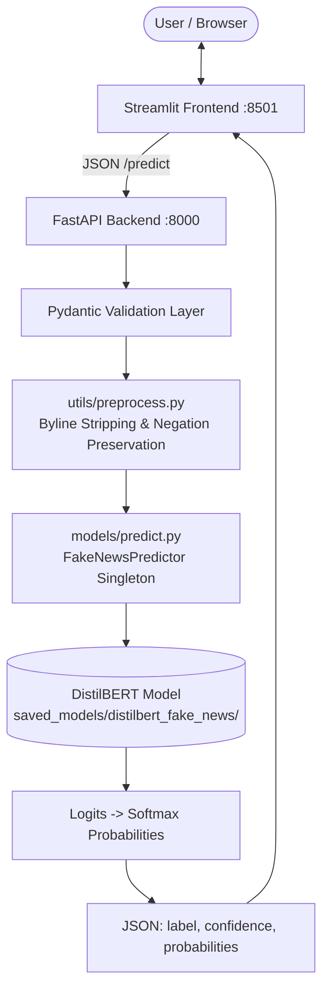

# Fake News Detector 📰🔍
### Deep Learning NLP Pipeline for News Authenticity Verification

[](https://www.python.org/)
[](https://pytorch.org/)
[](https://huggingface.co/)
[](https://fastapi.tiangolo.com/)
[](https://streamlit.io/)
[](https://docs.pytest.org/)

An end-to-end Machine Learning and Natural Language Processing (NLP) system that classifies news articles as **Real News** or **Fake News**. Built with a fine-tuned **DistilBERT** transformer backbone, an asynchronous **FastAPI** REST backend, and an interactive **Streamlit** dashboard.

---

## 📌 Problem Statement & Objectives

Online misinformation undermines public discourse, institutional trust, and factual decision-making. Automated detection systems can assist readers and moderators by screening sensational or fabricated patterns in claims.

### Core Objectives
1. **Accurate Stylistic & Semantic Classification**: Distinguish deceptive journalism from verified reporting using contextual bidirectional transformer embeddings.
2. **Leakage-Resilient Data Pipeline**: Prevent wire-service artifact leakage (e.g., removing publisher tags like `"Reuters -"`) and maintain strict train/val/test data separation.
3. **Decoupled Production Architecture**: Separate heavy neural inference into a dedicated REST microservice with typed schemas, independent health probes, and responsive client interfaces.
4. **Transparent Scoring**: Output per-class calibrated probability distributions rather than opaque binary classifications.

---

## ✨ Features

- **Transformer NLP Backbone**: Fine-tuned `distilbert-base-uncased` with custom classification head and sequence truncation handling.
- **Leakage-Free Preprocessing**: Wire byline stripping, HTML entity decoding, URL elimination, and negation-preserving stopword filtering (`"not guilty"` is preserved).
- **Production REST API**: FastAPI backend providing `/predict`, `/health`, and auto-generated Swagger UI (`/docs`).
- **Input Validation**: Pydantic v2 schemas enforcing string normalization, whitespace rejection, and maximum character bounds (up to 50,000 characters).
- **Interactive UI**: Streamlit web dashboard featuring confidence metrics, probability gauge bars, sample presets, and real-time backend health monitoring.
- **Comprehensive Test Suite**: 61 automated unit and integration tests covering preprocessing, tokenization, API contracts, client resilience, and zero data leakage.

---

## 🛠️ Technology Stack

| Layer | Technologies |
| :--- | :--- |
| **Model & NLP** | Hugging Face Transformers (`distilbert-base-uncased`), PyTorch, Datasets, NLTK |
| **Data Processing** | Pandas, NumPy, Scikit-learn |
| **Backend API** | FastAPI, Uvicorn, Pydantic v2, Python-dotenv |
| **Frontend UI** | Streamlit, Requests |
| **Testing & Quality** | Pytest, FastAPI TestClient, Pyright |

---

## 🏗️ Architecture & Data Flow



---

## 📂 Repository Structure

```text
Fake- News-Detector/
├── backend/
│   ├── __init__.py
│   └── main.py                     # FastAPI REST server & lifespan model loading
├── frontend/
│   ├── __init__.py
│   ├── api_client.py               # Robust HTTP client with error mapping
│   └── app.py                      # Streamlit dashboard interface
├── models/
│   ├── predict.py                  # Thread-safe FakeNewsPredictor inference wrapper
│   └── train_bert.py               # End-to-end DistilBERT training & evaluation pipeline
├── utils/
│   ├── __init__.py
│   └── preprocess.py               # Text normalization, byline removal, stopword filtering
├── scraper/
│   ├── __init__.py
│   └── news_fetcher.py             # Optional NewsAPI live headline ingestion
├── scripts/
│   ├── prepare_data.py             # Raw dataset deduplication and merging
│   └── setup_nltk.py               # Automated NLTK corpus dependency installer
├── data/
│   ├── .gitkeep                    # Tracks data directory in Git
│   └── processed_news.csv          # Cleaned dataset (excluded from Git via .gitignore)
├── saved_models/
│   ├── distilbert_fake_news/       # Trained model weights, tokenizer & eval_metrics.json
│   └── smoke_test_model/           # Lightweight baseline model for fast CI testing
├── tests/
│   ├── test_api.py                 # FastAPI endpoint & validation tests
│   ├── test_config.py              # Path and environment resolution tests
│   ├── test_dataset_pipeline.py    # Stratified split, label & leakage tests
│   ├── test_distilbert_integration.py # In-memory DistilBERT integration tests
│   ├── test_frontend_client.py     # Streamlit API client resilience tests
│   ├── test_model_pipeline.py      # Predictor error handling & mocked inference
│   ├── test_news_fetcher.py        # NewsAPI integration tests
│   ├── test_preprocessing.py       # Cleaning & negation-preservation tests
│   └── test_smoke.py               # End-to-end pipeline smoke tests
├── docs/
│   └── screenshots/                # Dashboard and API screenshots
│       └── .gitkeep
├── config.py                       # Central path anchors & environment variables
├── requirements.txt                # Python package dependencies
├── pytest.ini                      # Pytest runner configuration
├── pyrightconfig.json              # Python language server environment settings
├── .env.example                    # Environment variable configuration template
└── .gitignore                      # Excludes secrets, large data (>50MB), and binaries
```

---

## 📊 Dataset & Label Convention

The model is trained on the curated ISOT Fake News Dataset (covering political, world, and general news articles).

### Strict Project Label Standard
* **`0` = Real News**: Verified reporting from major news bureaus.
* **`1` = Fake News**: Fabricated stories, unverified claims, and deceptive clickbait.

### Data Cleaning Highlights
- **Publisher Leakage Removal**: Strips header signatures like `"WASHINGTON (Reuters) - "` to prevent the transformer from memorizing publisher names instead of textual semantics.
- **Negation Preservation**: Standard stopword removal strips `"not"`, which flips factual statements (e.g., *"not guilty"* becoming *"guilty"*). The custom preprocessing pipeline explicitly retains polarity words (`no`, `not`, `never`, `without`, `cannot`).

---

## 📈 Model Performance & Evaluation

The DistilBERT model was fine-tuned with stratified sampling and evaluated against an isolated, held-out test split. 

*Verified from [`saved_models/distilbert_fake_news/eval_metrics.json`](file:///d:/Fake-%20News-Detector/saved_models/distilbert_fake_news/eval_metrics.json):*

### Overall Evaluation Metrics
| Metric | Value |
| :--- | :---: |
| **Held-Out Test Accuracy** | **98.00%** |
| **Macro F1-Score** | **0.9800** |
| **Weighted F1-Score** | **0.9800** |
| **Final Training Loss** | `0.1299` |
| **Validation Loss (Epoch 2)** | `0.1485` |

### Per-Class Test Breakdown (450 Held-Out Samples)
| Class | Precision | Recall | F1-Score | Support |
| :--- | :---: | :---: | :---: | :---: |
| **Real News (0)** | 97.37% (`0.9737`) | 98.67% (`0.9867`) | 98.01% (`0.9801`) | 225 articles |
| **Fake News (1)** | 98.65% (`0.9865`) | 97.33% (`0.9733`) | 97.99% (`0.9799`) | 225 articles |

### Test Confusion Matrix
```text
                      Predicted Real (0)   Predicted Fake (1)
Actual Real (0):             222                   3
Actual Fake (1):               6                 219
```

### Training Hyperparameters
- **Base Architecture**: `distilbert-base-uncased` (6 layers, 768 hidden dim, 12 attention heads)
- **Epochs**: 2
- **Batch Size**: 8
- **Learning Rate**: `2e-5` (with AdamW optimizer & linear schedule)
- **Max Sequence Length**: 128 tokens
- **Seed**: 42 (Reproducible split: 70% Train [2,100], 15% Val [450], 15% Test [450])

---

## 🚀 Installation & Local Setup

### 1. Prerequisites
- Windows 10/11, macOS, or Linux
- Python 3.11+
- Git

### 2. Clone the Repository
```powershell
git clone https://github.com/<your-username>/Fake-News-Detector.git
cd Fake-News-Detector
```

### 3. Create & Activate a Virtual Environment
In Windows PowerShell:
```powershell
python -m venv .venv
.\.venv\Scripts\Activate.ps1
```
*(On macOS/Linux: `python3 -m venv .venv && source .venv/bin/activate`)*

### 4. Install Dependencies
```powershell
pip install --upgrade pip
pip install -r requirements.txt
```

### 5. Download NLTK Corpora
```powershell
python scripts/setup_nltk.py
```

### 6. Environment Configuration
Copy the template to initialize your local `.env`:
```powershell
Copy-Item .env.example .env
```
Default settings in `.env`:
```env
BACKEND_HOST=127.0.0.1
BACKEND_PORT=8000
BACKEND_URL=http://127.0.0.1:8000
SAVED_MODEL_DIR=saved_models/distilbert_fake_news
NEWS_API_KEY=your_optional_news_api_key
```

---

## 🖥️ Running the Application

To run the full stack, open **two separate terminal windows** with your virtual environment activated:

### Terminal 1: FastAPI Backend Service
```powershell
python -m uvicorn backend.main:app --reload --host 127.0.0.1 --port 8000
```
- API root: `http://127.0.0.1:8000`
- Interactive OpenAPI Docs: `http://127.0.0.1:8000/docs`
- Health check probe: `http://127.0.0.1:8000/health`

### Terminal 2: Streamlit Web Dashboard
```powershell
python -m streamlit run frontend/app.py
```
- Browser interface opens automatically at: `http://localhost:8501`

---

## 🔌 API Documentation & Examples

### Health Check Endpoint
`GET /health`

**Response (`200 OK`)**:
```json
{
  "status": "healthy",
  "model_loaded": true,
  "model_path": "D:\\Fake- News-Detector\\saved_models\\distilbert_fake_news",
  "device": "cpu",
  "version": "1.0.0"
}
```

### News Prediction Endpoint
`POST /predict`

**Request Headers**: `Content-Type: application/json`  
**Request Body**:
```json
{
  "title": "Federal Reserve Holds Benchmark Interest Rates Steady",
  "text": "The Federal Reserve announced on Wednesday that benchmark interest rates will remain unchanged following its scheduled monetary policy meeting."
}
```

**Response (`200 OK`)**:
```json
{
  "label": 0,
  "label_name": "Real News",
  "confidence": 0.9969,
  "probabilities": {
    "Real News": 0.9969,
    "Fake News": 0.0031
  },
  "cleaned_text": "federal reserve holds benchmark interest rates steady federal reserve announced wednesday benchmark interest rates remain unchanged following scheduled monetary policy meeting"
}
```

### PowerShell cURL Verification
```powershell
Invoke-RestMethod -Uri "http://127.0.0.1:8000/predict" -Method Post -ContentType "application/json" -Body '{"title": "Mars Discovery", "text": "NASA scientists identified organic molecules in Jezero crater."}' | ConvertTo-Json
```

---

## 🧪 Automated Testing

The project includes an extensive test suite verifying data pipelines, tokenization consistency, error resilience, and REST endpoints.

Run the entire test suite:
```powershell
python -m pytest tests/ -v
```

Run specific test modules:
```powershell
# Verify dataset splitting & duplicate purging
python -m pytest tests/test_dataset_pipeline.py -v

# Verify DistilBERT model weights and inference consistency
python -m pytest tests/test_distilbert_integration.py -v

# Verify FastAPI endpoints and status codes
python -m pytest tests/test_api.py -v
```

*Current Suite Status: **61 passed, 0 failed**.*

---

## 📸 Screenshots

To showcase the live user interface in your repository:
1. Save the dashboard screenshot to [`docs/screenshots/streamlit_ui.png`](file:///d:/Fake-%20News-Detector/docs/screenshots/).
2. Save the Swagger API screenshot to [`docs/screenshots/api_docs.png`](file:///d:/Fake-%20News-Detector/docs/screenshots/).

| Streamlit Dashboard | Interactive API Docs (`/docs`) |
| :---: | :---: |
|  |  |

*(If the images above show as placeholders, capture screenshots of the running app at `http://localhost:8501` and `http://127.0.0.1:8000/docs`, save them in `docs/screenshots/`, and commit them).*

---

## ⚠️ Limitations & Academic Disclaimer

1. **Benchmark vs. Real-World Accuracy**:
   The reported **98% accuracy** is achieved on a held-out test partition of the curated benchmark dataset. In real-world environments, misinformation involves multimodal manipulation (deepfakes, manipulated images), emerging geopolitical vocabulary, and domain shift that curated textual datasets do not fully capture.
2. **Stylistic Rather than Factual Verification**:
   Text classification models detect lexical and stylistic markers (e.g., hyperbole, conspiratorial rhetoric, sensational punctuation) rather than performing live entity cross-referencing or database fact-checking.
3. **Sequence Length**:
   Articles are truncated at sequence limits (`max_length = 128` to `256` tokens). Very long articles are evaluated primarily on their headline and introductory sections.

---

## 🔮 Future Improvements

- [ ] **Cross-Domain Benchmarking**: Evaluate zero-shot transfer on additional datasets (e.g., LIAR, FakeNewsNet, GossipCop).
- [ ] **Explainability & Attribution**: Integrate Integrated Gradients or LIME/SHAP token highlighting in the Streamlit UI to display which words triggered the fake news score.
- [ ] **Docker Containerization**: Add a `Dockerfile` and `docker-compose.yml` orchestrating FastAPI and Streamlit into single-command deployments.
- [ ] **Quantization & ONNX Export**: Export model to ONNX runtime with INT8 dynamic quantization for sub-10ms CPU inference.

---

## 👤 Author

Developed by **[Your Name]**

- **GitHub**: [github.com/your-username](https://github.com/your-username)
- **LinkedIn**: [linkedin.com/in/your-profile](https://linkedin.com/in/your-profile)
- **Portfolio / Email**: `your.email@example.com`

---

## 📄 License

This project is licensed under the MIT License — see the [LICENSE](LICENSE) file for details.
